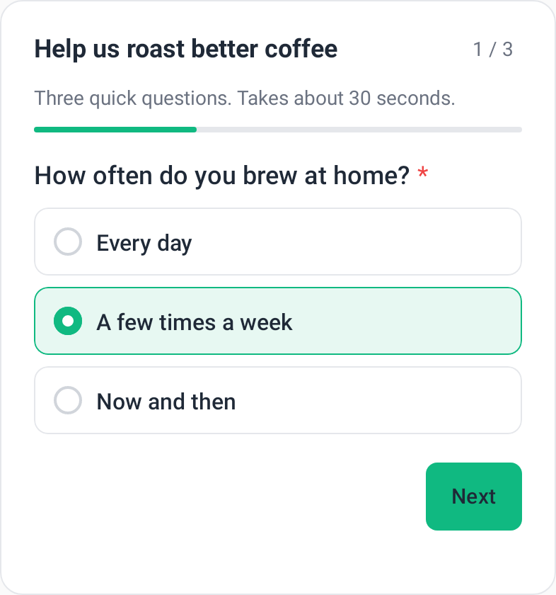
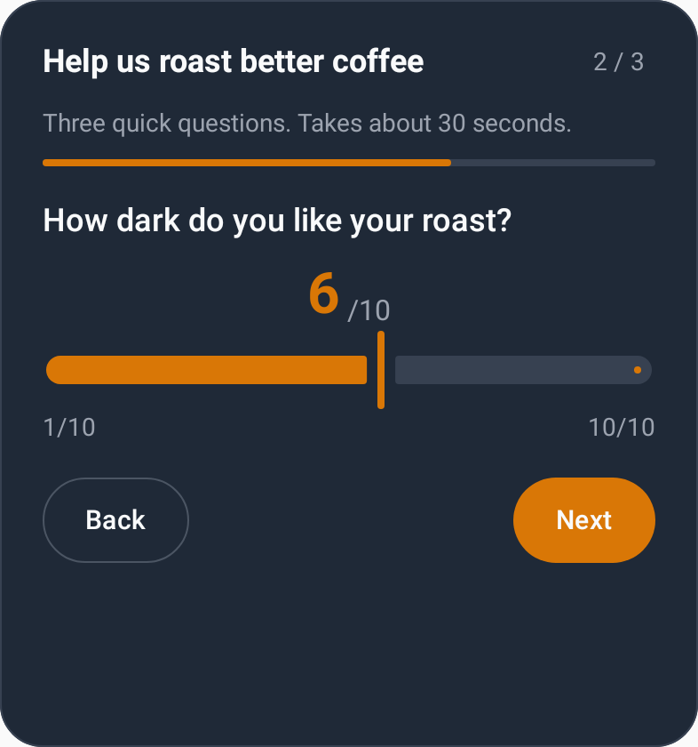

# qaid quests for iOS and Android

[](#coverage)

[qaid.dev](https://qaid.dev) quests drawn with real SwiftUI and Jetpack Compose views: the same quest you
built for [`@qaiddev/quests-embed`](https://github.com/qaiddev/quests-embed) on the web, shown inline in a
screen or as a sheet, with native text fields, sliders, date pickers and option lists. Its sister SDK,
[thumbs-native](https://github.com/qaiddev/thumbs-native), collects thumbs feedback.

| Platform | Install | Needs |
| --- | --- | --- |
| iOS | Swift Package Manager: `https://github.com/qaiddev/quests-native`, product `QaidQuests` | iOS 15+ |
| Android | The `android/qaidquests` module from this repo (`dev.qaid:quests:0.1.0` is not on Maven Central yet) | minSdk 26, compileSdk 35+, Compose compiler plugin |

<p>
  
  
</p>

A quest inline, in light mode, and the next step with `theme` set to dark, the pill preset and an amber accent. Drawn on Android.

You need your project's **embed key** (**Settings** → **API Keys**) and a quest that has been saved as a
version. Integration guide: https://qaid.dev/guides/quests-native. Exact API: [`ios/NOTES.md`](ios/NOTES.md),
[`android/NOTES.md`](android/NOTES.md).

## Set up

```swift
import QaidQuests

QaidQuests.configure(QaidQuestsConfiguration(apiKey: "YOUR_EMBED_KEY", appName: "My App"))

// Inline, in a SwiftUI screen
QaidQuestView(questId: "QUEST_ID") { answers in /* … */ }

// Or as a sheet
QaidQuests.present(questId: "QUEST_ID")
```

```kotlin
QaidQuests.configure(this, QaidQuestsConfig(apiKey = "YOUR_EMBED_KEY", appName = "My App"))

// Inline, in a composable
QaidQuest(questId = "QUEST_ID", onComplete = { answers -> /* … */ })

// Or as a sheet
QaidQuests.present(activity, "QUEST_ID")
```

UIKit apps embed `QaidQuestViewController(questId:)`; View-based Android apps use `QaidQuestView`.

## What it does

1. Fetches the quest's live version and draws one question per step, with the web embed's progress,
   Back/Next, required checks, validation messages, `visibleIf` branching, autoAdvance and thank-you screen.
2. Saves each answer to qaid a moment after it is given (create → per-answer save → submit, the web
   protocol). Unlike the web embed it checks every save: network and server failures retry, then wait on the
   device; anything qaid refuses is reported to `QaidQuests.onError`.
3. Offline, a finished quest is kept on the device (out of backups, up to 20 responses for 7 days) and sent in
   order at the next launch, on return to the foreground, or when the network comes back.
4. Follows light/dark mode, a saved quest theme (`themeId`) and your own `theme` overrides. Theme CSS has no
   native meaning and is ignored.
5. Every string it draws or speaks is in `text`, so you can pass your own translations.
6. A question type this version doesn't know is shown as a card saying so, not answered, and skipped.

Responses name the app as `app://<bundle id>` unless you set `pageUrl`; qaid checks that against a Domain
Restriction reversed (`com.example.app` passes `example.com`). The visitor id is shared with thumbs-native,
so feedback and quest answers from one install name one visitor.

## Develop

```sh
/usr/bin/swift test                                                     # iOS core, from the repo root
xcodebuild -scheme QaidQuests -destination 'generic/platform=iOS Simulator' build
cd android && ./gradlew --no-daemon :qaidquests:testDebugUnitTest       # JVM + Robolectric
```

Release: bump `QaidQuestsSDK.version`, `QaidQuestsSdk.VERSION` and the coordinates in
`android/build.gradle.kts`; tag `x.y.z` (the tag is the Swift release); then from `android/` run
`./gradlew --no-daemon :qaidquests:publishAndReleaseToMavenCentral` with `mavenCentralUsername`,
`mavenCentralPassword` and `signingInMemoryKey` in `~/.gradle/gradle.properties`.

Screenshots: the README's pictures are drawn by Robolectric, no device needed. From `android/`:

```sh
QAID_SCREENSHOT_DIR=../docs/screenshots \
  ./gradlew --no-daemon :qaidquests:testDebugUnitTest --tests '*ReadmeScreenshots*'
```

## Coverage

```sh
scripts/coverage.sh            # both platforms, then coverage-badge.json
scripts/coverage-ios.sh        # swift test + llvm-cov, QaidQuestsCore only
scripts/coverage-android.sh    # unit + Robolectric tests, Kover
```

All logic lives in the core (the `QuestSession` state machine, `visibleIf`, validation, wire encoding, the
response protocol, the offline queue, theme mapping), which each platform tests without a device and gates:
lines, functions and regions on iOS, lines and branches on Android. Android also runs Robolectric tests of
every question type and the full flow, reported but not gated. SwiftUI views stay thin. The badge shows the
lower of the two platforms' gated line coverage.

## License

MIT
